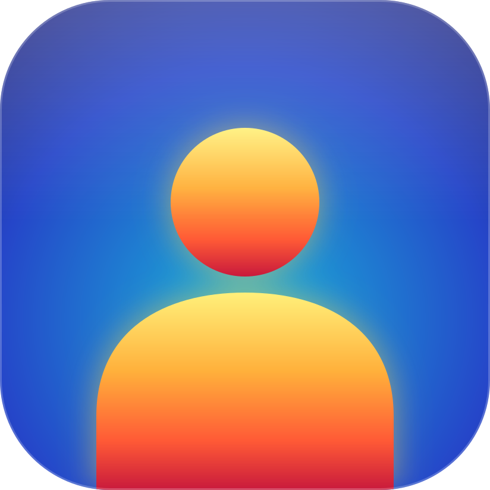
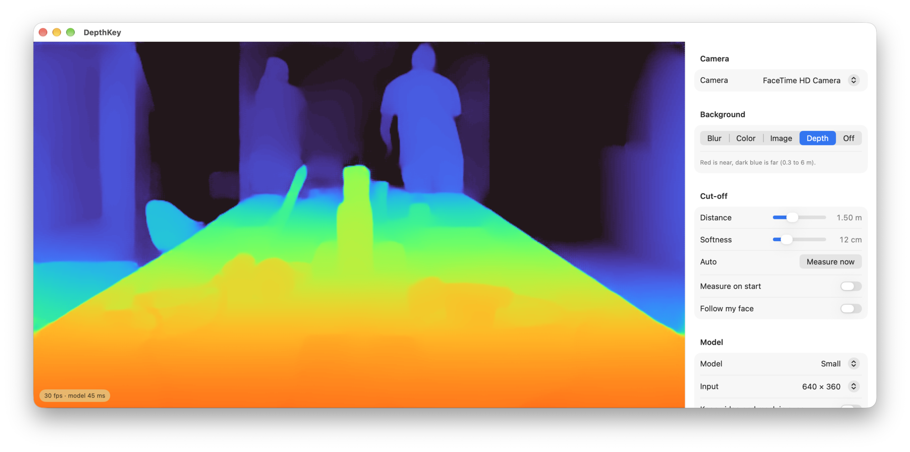

# DepthKey

Webcam background removal by **depth** instead of a green screen or person segmentation:
everything nearer than a cut-off distance stays, the rest is blurred, replaced or keyed out.
Depth comes from Apple's [Depth Pro 2](https://huggingface.co/apple/DepthPro2), which estimates
metric depth per pixel and stays steady from frame to frame.

Because it cuts by distance, it keeps whatever is near you (the mug you hold up, your chair, a
second person), not just a detected person.

Two ways to run it:

| | Where the model runs | Speed | For |
|---|---|---|---|
| [**Mac app**](mac/) | Your Mac's GPU (Core ML) | real time | Zoom, Meet, Slack, OBS, any app that takes a camera |
| [**Browser demo**](#browser-demo) | A Docker container (CPU) | ~3–5 fps | Trying it out |

## Mac app

DepthKey, a native app for Apple silicon and macOS 15+. Pick the camera, background and cut-off
in its window; it sends the result to the OBS Virtual Camera (OBS 30+ installed).



<sub>Depth view of a still photo (red near, blue far). Photo: [Crew on Unsplash](https://commons.wikimedia.org/wiki/File:Couple_working_at_home_(Unsplash).jpg), CC0.</sub>

```bash
mac/build.sh run
```

Install, use and build: [`mac/README.md`](mac/README.md).

## Browser demo

The browser captures the webcam and streams frames over a WebSocket to a container running
Depth Pro 2; the page composites the result.

```bash
docker compose up -d --build
open http://localhost:8000
```

Browsers allow the camera only on `https` or `localhost`. To serve it from another machine,
put it behind an HTTPS proxy (`compose.devbox.yml` is an example with Caddy).

- **Auto** sets the cut-off to the depth in the middle of the frame + 40 cm.
- **Model input width**: 256 ≈ 5 fps, 320 ≈ 3 fps on an 8-core CPU.
- **Keep video and mask in sync** shows only processed frames; off gives smooth video with a lagging mask.
- **Test image** tab: the depth of one photo or camera snapshot at up to 1536 px, colored like
  Apple's `depth-pro-2` CLI (turbo: red near, dark blue far), with a download.

Settings in `compose.yml`:

| Variable | Default | |
|---|---|---|
| `MODEL` | `depthpro2-s` | `depthpro2-b/l/h` are sharper but far too slow on a CPU; rebuild with `--build-arg MODEL=…` |
| `WINDOW` | `2` | Frames the model attends to; higher is steadier and slower |
| `TORCH_THREADS` | `8` | |

## License

The code in this repository is under the [MIT License](LICENSE). It is not affiliated with Apple.
The Depth Pro 2 code and weights are downloaded at build or run time and are under Apple's
licenses: the
[weights](https://github.com/apple-aiml-research/ml-depth-pro-2/blob/main/LICENSE_MODEL) are for
non-commercial research use only.
