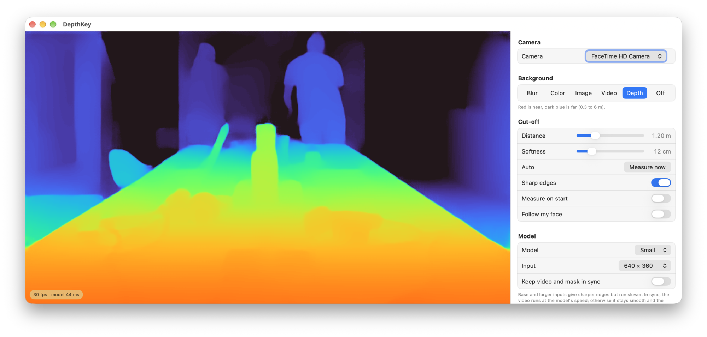

# DepthKey for Mac (Apple silicon)

A native macOS app. It runs Depth Pro 2 on the Mac GPU (Core ML), keeps everything nearer than a
cut-off distance, replaces the background, and sends the result to the **OBS Virtual Camera**.
Zoom, Google Meet, Slack, Teams or OBS then use that as a normal camera.

Needs Apple silicon, macOS 15+ and OBS 30+ (only for its virtual camera).



## Install

1. Install OBS once: `brew install --cask obs`. Open OBS, click **Start Virtual Camera** (allow
   the camera extension if macOS asks: System Settings › General › Login Items & Extensions ›
   Camera Extensions), click **Stop Virtual Camera** and quit OBS.
2. Open `DepthKey.dmg` and drag DepthKey to Applications.
3. DepthKey is not notarized. The first time you open it, macOS blocks it: go to **System Settings ›
   Privacy & Security**, click **Open Anyway** next to DepthKey and confirm.
4. Allow the camera. On first start DepthKey downloads the models from Hugging Face (~150 MB,
   once) and compiles them for the GPU.

## Use

- **Camera**: pick the camera by name. The OBS Virtual Camera is left out of the list, because
  reading it back would loop.
- **Background**: Blur, Color (to key out in OBS with a Chroma Key filter), Image, Video, Depth
  (red near, dark blue far) or Off.
- **Video** loops without sound. Choose a file, or paste a link and press Return:
  - a direct link to an `.mp4`, `.mov` or `.m3u8` (HLS) plays as is;
  - a video page (YouTube, Vimeo and the other sites [yt-dlp](https://github.com/yt-dlp/yt-dlp)
    knows) is downloaded once in H.264 up to 1080p, then plays from
    `~/Library/Application Support/DepthKey/Videos`. Needs `brew install yt-dlp`;
  - a live stream (`rtsp://`, `rtmp://`, `srt://`, `udp://`) is decoded with ffmpeg and reconnects
    when it drops. Needs `brew install ffmpeg`.

  Use videos you have the right to use.
- **Light wrap** (Blur, Image, Video): the background's light spills softly over your outline, so
  you look like part of the scene instead of pasted on top. Off for Color, where it would spoil a
  chroma key.
- **Cut-off**: everything nearer stays. **Measure now** sets it to the depth of your face + 40 cm
  (the middle of the frame if it finds no face). **Follow my face** measures twice a second and
  eases the cut-off along as you lean in or back. Softness widens the transition. **Sharp edges**
  shapes the cut along the edges in the camera image (hair, fingers) instead of the blockier
  depth map.
- **Model**: Small is the default. Base is sharper and about 4× slower. A larger input gives
  sharper edges at a slower speed. The video runs at the camera's 30 fps with the latest depth,
  so the mask can trail a fast move slightly. **Keep video and mask in sync** makes each frame
  wait for its own depth instead, at the model's speed. The preview shows the fps and model time.

Settings are kept between launches. Closing the window keeps DepthKey running in the menu bar, so
the call keeps its camera; quit from the menu bar icon or with ⌘Q. **Open at login** is under
General.

Shortcuts (Effect menu and the menu bar icon): ⌘1 Blur · ⌘2 Color · ⌘3 Image · ⌘4 Video · ⌘5 Depth · ⌘0 Off ·
⌘− / ⌘= cut-off 5 cm nearer / farther · ⌘R measure · ⌘F follow my face.

In the calling app, choose **OBS Virtual Camera** as the camera. Turn off that app's own
background blur, and don't start OBS's own virtual camera while DepthKey is running (there is only
one). If DepthKey shows a macOS Portrait or Background effect warning, turn it off for DepthKey in
Control Center › Video Effects.

## Speed

Apple's numbers for Small at window 4 on an M4 Max GPU:

| Input | Model time |
|---|---|
| 640 × 360 (default) | 13 ms |
| 854 × 480 | 26 ms |
| 896 × 512 | 30 ms |
| 1280 × 720 | 88 ms |

Older chips are slower: an M1 Pro takes about 50 ms at 640 × 360, so the mask updates about 20 times a second while the video stays at 30 fps. The GPU beats the Neural
Engine for this model.

## Build

Needs Xcode 16+ and [XcodeGen](https://github.com/yonaskolb/XcodeGen) (`brew install xcodegen`).

```bash
./build.sh          # build/DepthKey.app (ad-hoc signed)
./build.sh run      # build and open
./build.sh dmg      # also build/DepthKey.dmg
SIGN_IDENTITY="Apple Development" ./build.sh run   # sign with your certificate
```

To try it without a camera (or to take screenshots), feed it a still image; settings can be
overridden for that run the same way:

```bash
open build/DepthKey.app --args -DepthKeyTestImage photo.jpg -mode depth -mirrorPreview '<false/>'
```

With the ad-hoc signature, macOS asks for camera access again after every rebuild. Signing with
your own certificate avoids that. To work in Xcode, run `xcodegen generate` and open
`DepthKey.xcodeproj`. The project is generated from `project.yml` and is not committed.

The models are stored in `~/Library/Application Support/DepthKey/Models`. Delete that folder to
download them again.

## Why OBS's virtual camera

A virtual camera of DepthKey's own would be a Core Media I/O camera extension. macOS only loads
one signed with a paid Apple Developer Program team, and users cannot approve an unsigned one the
way they can an unsigned app. Until then, DepthKey feeds OBS's camera extension through its sink
stream, as OBS itself does.

The model weights are licensed for non-commercial research use only.
